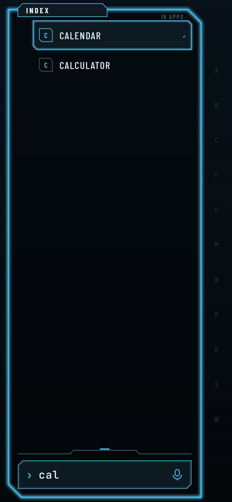

# Mai Launcher

Android home screen replacement with a calm, minimal sci-fi hand-terminal
look: one glowing frame, one subject, one thumb. Local, private, no internet
permission.

| Deck | Index | Search |
|---|---|---|
|  |  |  |

Concept: [`project-docs/KONZEPT.md`](project-docs/KONZEPT.md)

## Status

Phase 2 (in progress): Deck (home), Index (all apps, search, A–Z rail,
"likely now" predictions), dock, side rail with real device state.
Next: command line actions, Signals and Media (notification access), Comms.

## Build

```sh
./gradlew :app:testDebugUnitTest :app:lintDebug :app:assembleRelease
```

Requires JDK 17+ and the Android SDK (compileSdk 36). CI builds
`mai-launcher.apk` on every push. Install it, press Home and pick
"Mai Launcher" as the default home app.

Fonts: Barlow, Barlow Condensed, JetBrains Mono (SIL OFL 1.1, see `licenses/`).
