# Mai Launcher

Android home screen replacement with a calm, minimal sci-fi hand-terminal
look: one glowing frame, one subject, one thumb. Local and private: the only
network access is the RSS/Atom feeds you add yourself.

| Deck | Forecast | Deck (live) | Signals | Media | Settings | News | Comms | Command | Setup / edit | Index |
|---|---|---|---|---|---|---|---|---|---|---|
| 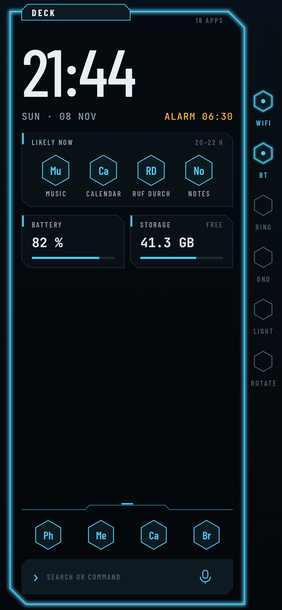 | 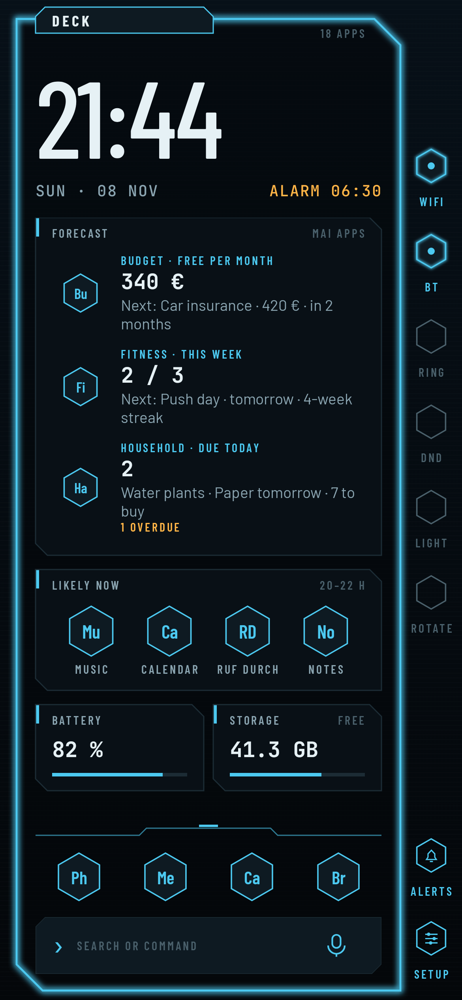 | 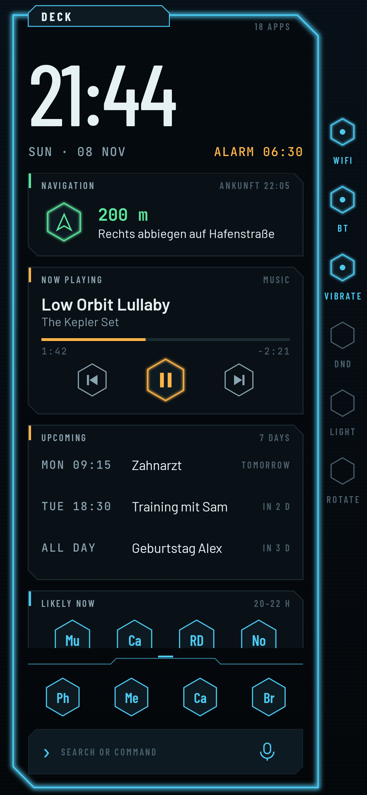 | 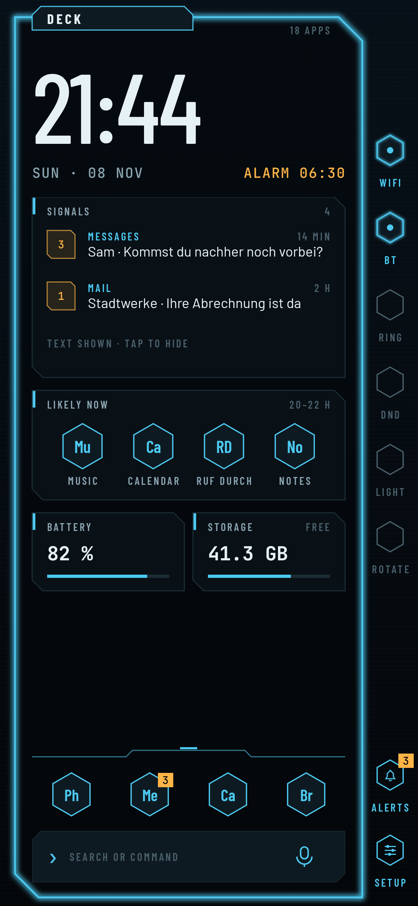 | 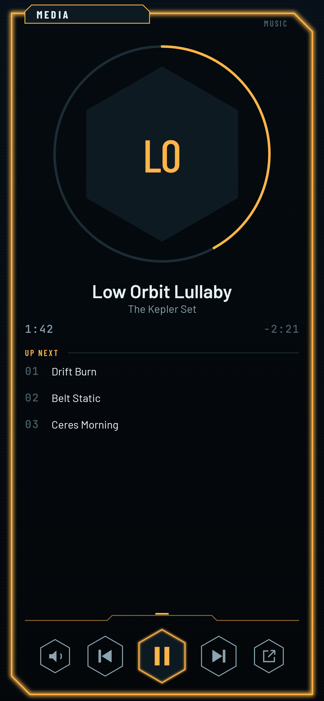 | 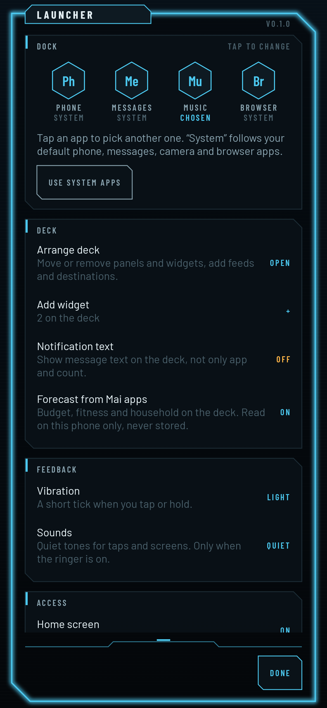 | 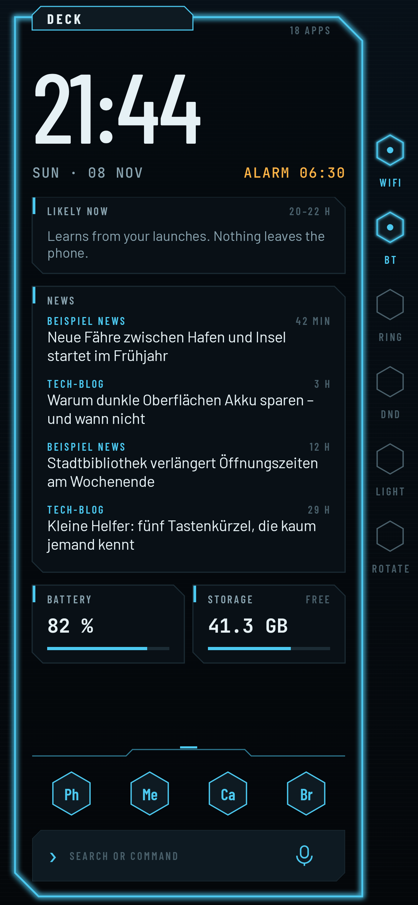 | 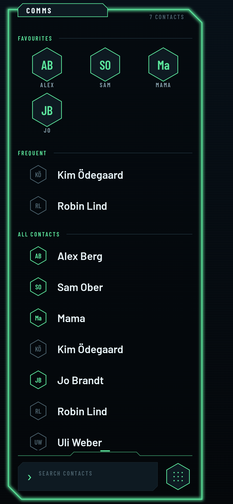 | 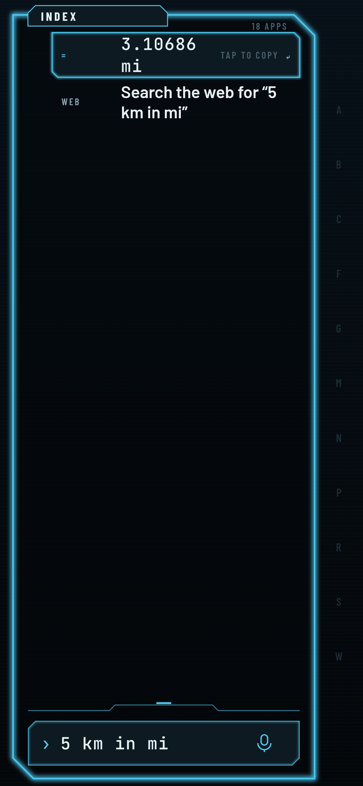 | 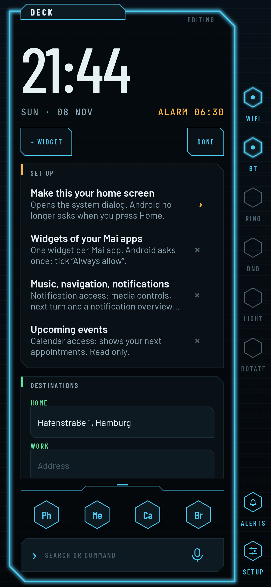 | 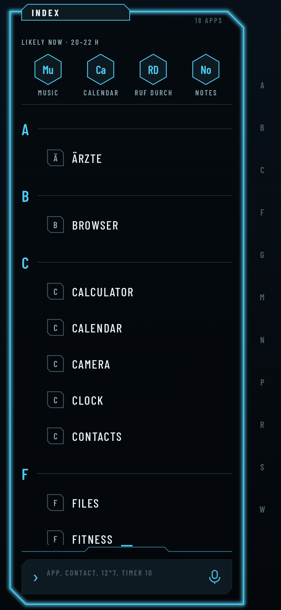 |

Concept: [`project-docs/KONZEPT.md`](project-docs/KONZEPT.md)

## Status

Deck (home) with now playing, navigation (next turn from the maps app),
upcoming events, quick destinations, hosted Android widgets (one widget of
each installed Mai app is added automatically), a news panel
for your own RSS/Atom feeds (HTTPS only, text only) and an edit mode;
Index (all apps, search, A–Z rail, "likely now") with a command line
(calculator, units, percent, timer/alarm, settings, dial a number, contacts,
web search on tap); Comms (swipe right on the Deck: favourites, frequent,
contact search, keypad; calls are handed to the phone app); Media (swipe left
on the Deck: seek ring, up next, output, music apps when idle); Signals
(notification digest on the Deck with counts on the Dock, text hidden by
default, nothing stored); voice input from the mic in the command line
(on-device recognition where available); side rail for Wi-Fi, BT,
sound mode (ring/vibrate/mute), DND, torch and rotation, plus ALERTS (opens
the notification shade) and SETUP: launcher settings for the dock apps,
arranging the deck, vibration and sounds (off by default, only with the
ringer on), access, and export/import of the layout as a small text file
(dock, widgets, feeds, destinations, settings; never app history or
contacts). A Forecast panel on the Deck shows budget (free per month, next
irregular payment), fitness (week goal, next workout) and household (due
today, bins, shopping) from the other Mai apps; they only share it with
Mai apps signed with the same key. The Deck has no vertical swipes, so panels and widgets
scroll freely; search opens from the search bar. Every permission is
optional and asked for from a "Set up" panel.
Next: lock-screen and gesture polish, more command verbs.

Privacy: the only network access is fetching the feeds you add yourself.

## Build

```sh
./gradlew :app:testDebugUnitTest :app:lintDebug :app:assembleRelease
```

Requires JDK 17+ and the Android SDK (compileSdk 36). CI builds
`mai-launcher.apk` on every push.

## Install

Open the APK, then tap "Set as home screen" in the Set up panel.

**Google Play Protect may block it** ("App wurde zum Schutz deines Geräts
blockiert", only an OK button). Google blocks apps installed from a browser,
messenger or file manager that declare a notification listener, which the
launcher needs for the media player and navigation. Signing does not change
this. Ways around it:

- Play Store → profile picture → Play Protect → ⚙ → turn off "Scan apps with
  Play Protect", install the APK, turn it back on.
- Or install over USB: `adb install -r mai-launcher.apk`.

Notification access stays off until you grant it in the Set up panel.

**Stable signature for updates.** Branch builds are signed with the CI
runner's debug key, which changes between runs, so an update over an existing
install can fail ("App nicht installiert"). Pushes to `main` are signed with
the upload key once these repository secrets are set (Settings → Secrets and
variables → Actions): `ANDROID_KEYSTORE_BASE64`, `ANDROID_KEYSTORE_PASSWORD`,
`ANDROID_KEY_ALIAS`, `ANDROID_KEY_PASSWORD` (same names as in the other Mai
apps, so the same upload keystore can be reused). Locally, a `key.properties`
in the project root with `storeFile`, `storePassword`, `keyAlias` and
`keyPassword` does the same; it is in `.gitignore`.

Fonts: Barlow, Barlow Condensed, JetBrains Mono (SIL OFL 1.1, see `licenses/`).
