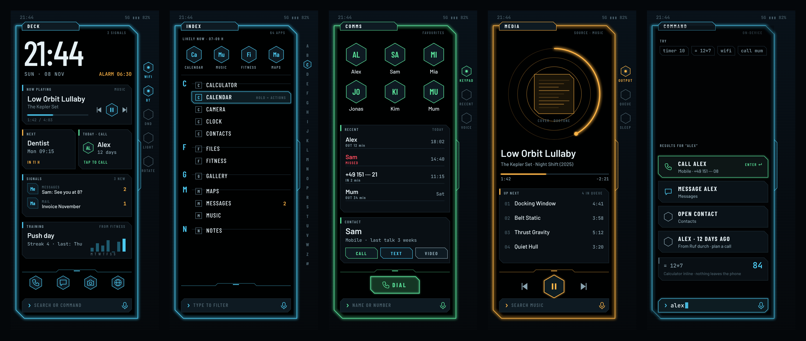
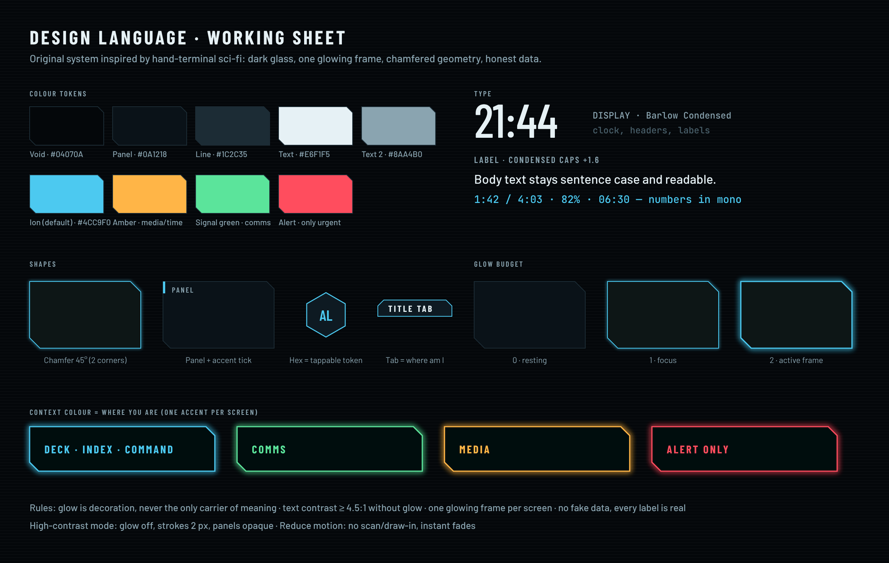
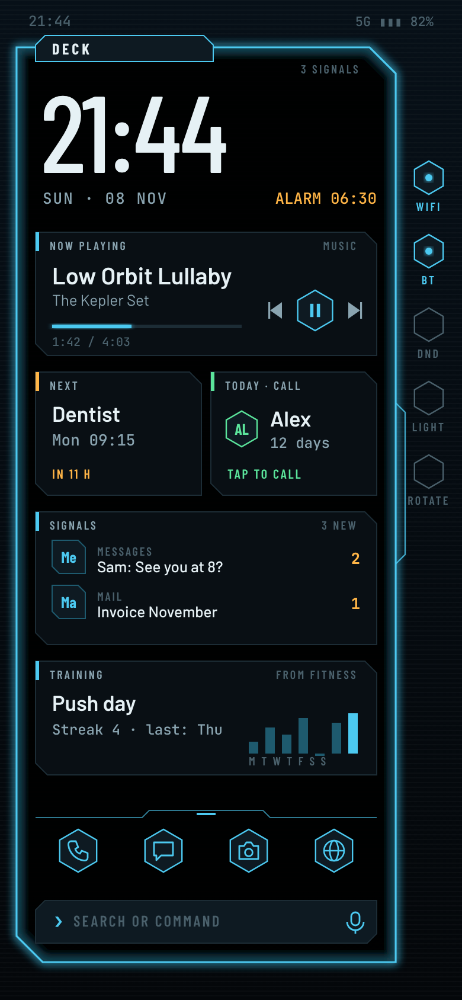
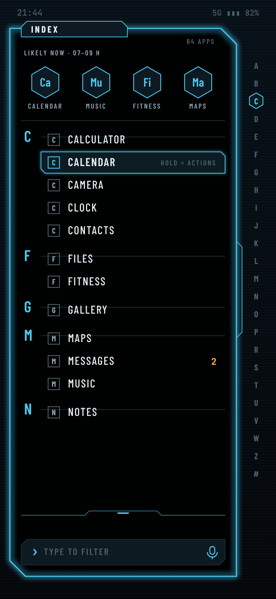
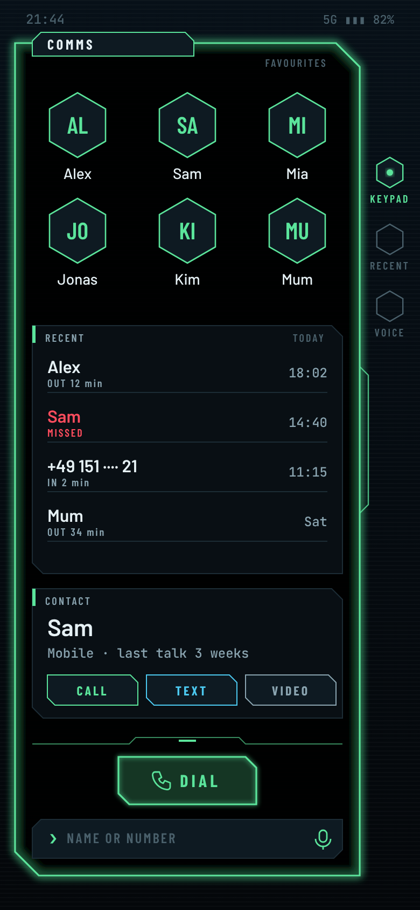
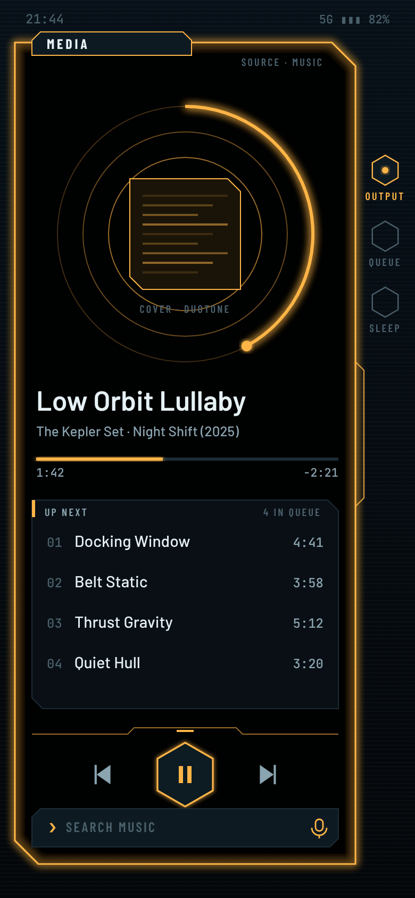
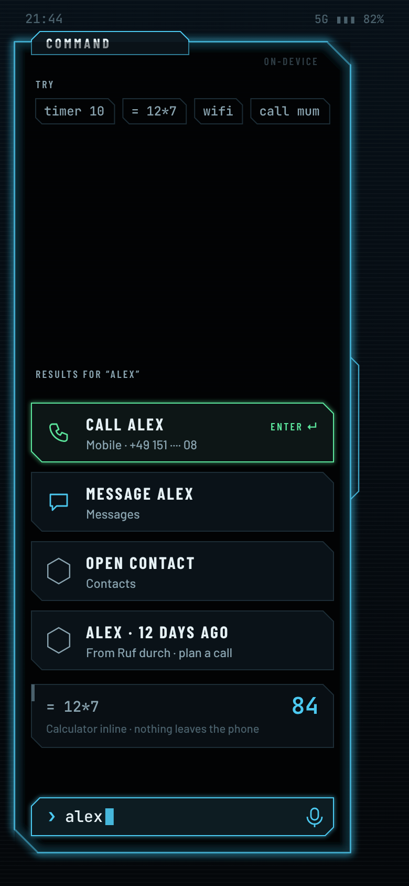

# Mai Launcher: Concept (Phase 1: design and structure)

As of 08.11.2026 · Status: draft, no code yet · Repo: `mai-space/mai-launcher`
Working name: **Mai Launcher** (display name open, see open decisions)

Mockups: [`mockups/`](mockups/) (SVG sources plus PNG renders, overview in
[`mockups/overview.png`](mockups/overview.png), generator script
`mockups/generate_mockups.py`).



## Idea

A home screen replacement that looks like a hand terminal from a sci-fi
series (dark glass, one glowing frame, chamfered edges, small condensed
labels) but that is **calmer and more useful than the stock launcher**, not
louder. The look in the show works because every screen has one clear
subject and a strong frame around it. We keep exactly that and drop the
parts that only work on camera: fake telemetry, scrolling noise text, tiny
unreadable labels, constant animation.

Design principle in one sentence: **one glowing frame, one subject, one
thumb.** Each screen has one accent colour that tells you where you are,
one primary thing to do, and that thing is reachable with the thumb of the
hand holding the phone.

The design is original. Inspiration taken from the reference images (all
from the show and fan art) is limited to general ideas: transparent dark
panels, a frame that glows in one colour, a side rail of round/hex status
buttons outside the frame, a title tab on the frame, a grip zone at the
bottom, layered cards. No logos, names, fonts, symbols or screen layouts
from the show are used, and nothing should be named after it.

### What the references teach (and what we change)

| In the references | Why it looks good | What we do with it |
|---|---|---|
| Frame glows in **one** colour (yellow, blue, red) | Instantly readable "mode", strong silhouette | Context colour per area: Ion blue for home/apps/command, green for calls, amber for media, red reserved for alerts |
| Status buttons **outside** the main frame on a side rail (NET/DATA/COMM) | Separates "state of the device" from "content" | Side rail for quick status and toggles, and for the A–Z scrubber in the app list |
| Title tab sticking out of the frame ("NO NEW MESSAGES") | Tells you where you are at a glance | Every screen has a tab with its name and one meta value |
| Grip area at the bottom where the thumb holds the device | Physical, ergonomic | **Grip zone**: the bottom third holds the main controls and the command line |
| Overlapping cards (contacts under messages) | Depth without 3D | Sheets slide up over the screen and dim it; at most two layers |
| Dense fake data in tiny fonts | Looks busy on camera | **Dropped.** Every label shows real data or is left out |
| Physical translucent glass | Can't do that | Near-black OLED background, faint scan-line texture, transparent panels over it |

---

## 1. Design language

Working sheet: [`mockups/00_design-language.png`](mockups/00_design-language.png)



### Colour

Dark only by design (the look does not translate to light mode, and OLED
black saves battery). Tokens:

| Token | Value | Use |
|---|---|---|
| `void` | `#04070A` | Background, near black (pure black makes glow look cheap) |
| `panel` / `panel2` | `#0A1218` / `#0E1A22` | Panels, 85 % opacity over the background |
| `line` | `#1C2C35` | Panel outlines at rest, separators |
| `text` / `text2` / `text3` | `#E6F1F5` / `#8AA4B0` / `#4A606B` | Primary, secondary, labels and disabled |
| `ion` (default accent) | `#4CC9F0` | Deck, Index, Command |
| `signal` | `#5BE49B` | Comms (calls, contacts) |
| `amber` | `#FFB547` | Media, time-bound things (alarm, next event), badges |
| `alert` | `#FF4D5E` | Only urgent: missed call, battery below 15 %, failed backup |

The user can swap the base accent (Ion, Amber, Signal, plus 2–3 more such
as violet and white) in settings. Context colours shift with it so that
the three areas stay distinguishable. Optional: follow Android's Material
You wallpaper colour for the base accent.

### Typography

All fonts open (SIL OFL), **bundled in the APK**, never downloaded.

- **Display and labels:** Barlow Condensed (500–700). Clock, screen titles,
  section labels in caps with +1.6 letter spacing. Condensed caps carry most
  of the "terminal" feel.
- **Body:** Barlow (400–600), sentence case. Names, song titles, message
  previews. Never all caps for anything longer than three words.
- **Numbers:** JetBrains Mono. Times, durations, percentages, counts.
  Tabular figures mean a running clock or timer never jitters.
- Minimum sizes: labels 10 sp, body 13 sp. Follows the system font scale;
  layouts are tested at 130 % and 200 %.

### Shape

- **Chamfer** (45° cut) instead of rounded corners, normally on two
  opposite corners (top right, bottom left). Main frame 22 dp, panels
  10 dp, buttons 7 dp.
- **Panel with accent tick:** a 3 × 16 dp bar of the context colour in the
  top-left corner and a caps label. This is the whole widget chrome.
- **Hexagon = tappable token.** Contacts, quick toggles, pinned apps,
  primary buttons. If it's a hexagon, you can tap it. Plain text is never a
  button without an outline.
- **Title tab** on the main frame: screen name plus one meta value
  ("3 SIGNALS", "64 APPS").
- **Notch** on the right edge of the frame where the side rail docks.
- **Grip line** with a centre notch marks the start of the thumb zone.

### Glow budget

Glow is the signature, so it must stay rare to stay special:

| Level | Where | How |
|---|---|---|
| 0 resting | All panels | 1 dp outline in `line`, no blur |
| 1 focus | Focused/selected item, primary action, progress bar | 2 dp blur, 1 layer |
| 2 active frame | The one main frame of the current screen | 4 dp blur, 2 layers |

Rules: **one level-2 glow per screen.** Glow is never the only carrier of
meaning (state is also shown by fill, icon or text). Text reaches at least
4.5:1 contrast without the glow. Implementation: blur pre-rendered into a
cached layer, not recomputed per frame.

### Icons

Android 13+ apps ship a **monochrome icon layer** (themed icons). We draw
every app in the context colour from that layer, so foreign apps fit the
look instead of breaking it. Apps without one get a **two-letter token**
("Ca", "Mu") in a frame, exactly like the old terminal labels. Optional per
app: show the original colour icon.

### Motion

- **Power-on:** when the home screen appears (unlock, home button), the
  frame outline draws itself in 180 ms, panels fade in 40 ms apart. Total
  under 250 ms; the first frame is already usable.
- **Sheets:** slide from the grip zone upwards, with the background dimmed
  to 40 %. Back gesture closes them (predictive back supported).
- **Data changes:** numbers tick to the new value (mono font keeps them in
  place), progress bars grow.
- **No idle animation.** No pulsing, no scan line running across the
  screen. A still screen is a calm screen and saves battery.
- Respects Android's "remove animations" and animator duration scale.
- Haptics: short tick on every hexagon tap, double tick on long-press.

### Accessibility and comfort modes

- **High contrast:** glow off, strokes 2 dp, panels opaque, text2 brighter.
- **Reduce motion:** no draw-in, instant fades.
- **Large mode:** fewer panels on the Deck, bigger hexagons, list rows
  56 dp.
- TalkBack labels for every token ("Alex, favourite, call"), logical focus
  order top to bottom, grip zone last.
- Touch targets at least 48 dp, even where the visual hexagon is smaller.

---

## 2. Structure and navigation

Five areas, all reachable from the Deck with one gesture. No hidden
gestures that you must learn; every gesture also has a visible button.

```
                    swipe down: Android notification shade
                                   ▲
   swipe right: COMMS  ◀────  DECK (home)  ────▶  swipe left: MEDIA
                                   │
                    swipe up: INDEX (all apps)
                    tap command line / long-press home: COMMAND
```

| Area | Context colour | Purpose | Mockup |
|---|---|---|---|
| **Deck** | Ion | Home screen: clock, panels (widgets), dock, command line | `01_deck` |
| **Index** | Ion | All apps, likely apps, search | `02_index` |
| **Comms** | Signal green | Favourites, recents, keypad, contact actions | `03_comms` |
| **Media** | Amber | Whatever is playing, from any app; queue, output | `04_media` |
| **Command** | Ion | Assistant: search, actions, calculator, voice | `05_command` |

Fixed elements on every screen:

1. **Title tab** (where am I) and **side rail** (device state, or an A–Z
   scrubber in the Index).
2. **Grip zone** (bottom ~30 %): the primary controls of the screen. On
   the Deck the dock; on Media play/skip; on Comms the dial button.
3. **Command line** at the very bottom, always in the same place. Typing
   anywhere goes to Command, filtered by context (in Comms it searches
   contacts first, in Media music).

Home button: from anywhere returns to the Deck; on the Deck it closes open
sheets, and a second press resets the Deck scroll position.

### 2.1 Deck (home)



- **Clock block:** large time, date, next alarm (amber). Tap clock opens
  the clock app, tap alarm opens alarms.
- **Panels** (widgets, see section 4) in a single column, scrollable;
  the first screen shows what matters most. Default set: Now playing, Next
  event, Today's call (from Ruf durch), Signals, one Mai app panel.
- **Side rail:** Wi‑Fi, Bluetooth, Do not disturb, torch, rotation. Shows
  state; tap toggles where Android allows it (torch, DND with permission),
  otherwise opens the system quick panel for that setting (Android 10+
  does not let apps toggle Wi‑Fi directly). Long-press opens the full
  setting.
- **Dock:** four pinned apps as hexagons in the grip zone.
- **Command line** below the dock.
- Edit mode: long-press empty space → panels get handles, add/remove
  panel, change dock, change accent. Changes are undoable (snackbar
  "Undo" for 10 s).

### 2.2 Index (all apps)



- **Likely now:** four apps predicted from your own launch history by time
  of day and weekday ("07–09 h"). Computed locally from the launcher's own
  launch log, no usage-access permission needed. Tap-and-hold on a
  suggestion explains why it's there and lets you hide it.
- **A–Z list** in condensed caps with letter headers; the side rail
  becomes an A–Z scrubber (drag with the thumb, haptic tick per letter).
- **Filter by typing** in the command line; matches on name, initials
  ("gm" → Google Maps style), and user-set aliases.
- Long-press an app: app shortcuts (Android `LauncherApps` shortcuts),
  pin to dock, hide, app info, uninstall.
- Hidden apps and work profile apps in separate tabs (work profile is
  supported by `LauncherApps`; private space on Android 15 too).
- Optional grid view for people who prefer icons.

### 2.3 Comms (phone)



- **Favourites** as six large hexagons with initials (photos optional,
  then shown duotone in the context colour).
- **Recents** with clear words, not just icons: OUT / IN / MISSED, missed
  in alert red.
- **Contact sheet:** CALL / TEXT / VIDEO buttons, last talk ("3 weeks"),
  link to Ruf durch if installed.
- **Dial** button in the grip zone opens the keypad as a sheet.

The phone has two depth levels, see open decision 2:

| Level | What it can do | What it needs |
|---|---|---|
| **A: Launcher phone** (start) | Favourites, contacts, keypad; the call itself is handed to the normal phone app (`ACTION_DIAL`, or `ACTION_CALL` with permission) | `READ_CONTACTS` (optional) |
| **B: Full phone app** (later) | Own call log, own in-call screen in our design, own incoming-call screen | Default phone app role (`ROLE_DIALER`), `InCallService`, `READ_CALL_LOG`, `CALL_PHONE`. Google Play only grants call log access to the default phone app |

Recents in the mockup need level B; at level A that panel shows "Frequent"
(from our own log of calls started through the launcher) instead.

### 2.4 Media



- **Controls whatever is playing** in any app (music, podcasts, audio
  books) via Android's media sessions. That needs notification access,
  which the launcher asks for anyway for badges (section 5).
- Big progress ring around the cover. The cover is shown **duotone** in
  the context colour by default (keeps the look calm), with a toggle for
  original colour.
- Up next (if the app shares its queue), output device (opens the system
  output switcher), sleep timer.
- Play/pause/skip as large controls in the grip zone. Seek by dragging on
  the ring.
- If nothing plays: last session with "resume", plus quick start buttons
  for the user's music apps.
- **Own local player** (play files from the phone) is a separate decision,
  see open decision 3. Recommendation: control first; a local player can
  come later as its own module.

### 2.5 Command (assistant)



The "assistant" is a **command line first**: one input that understands
apps, contacts, settings and a few verbs. Results stack **upwards from the
input**, so the best result is closest to the thumb, and Enter runs it.

Built-in, all on the device:

| You type | Result |
|---|---|
| app name / initials | Open app, or its shortcuts |
| contact name | Call, message, open contact; "last talk" hint from Ruf durch |
| `= 12*7`, `5 km in mi`, `20 % of 64` | Inline answer, copy on tap |
| `timer 10`, `alarm 6:30`, `stopwatch` | Hands off to the clock app (`AlarmClock` intents) |
| `wifi`, `bluetooth`, `display`, … | Opens that settings page |
| `note …` | Quick note (local, exportable) |
| `call mum`, `text sam` | Direct action |
| anything else | "Search the web for …" via the default browser, only on tap |

**Voice:** hold the mic (or long-press home) → speech is recognised with
Android's **on-device** recogniser (Android 12+), then goes into the same
command line. Nothing is sent to a server by us.

The launcher can also register as Android's **digital assistant** app, so
that the system assistant gesture opens Command. Optional, the user picks
it in Android settings.

A cloud AI assistant is deliberately **not** part of the concept: it would
need internet access and send what you type off the device. See open
decision 4.

### 2.6 Notifications ("Signals")

- Swipe down on the Deck opens the normal Android shade (reliable,
  actionable, nothing to rebuild).
- The **Signals panel** on the Deck shows a digest: app token, sender or
  title, unread count. Tap opens the notification's own action.
- **Badges** (amber counts) on dock, Index and Signals.
- Privacy setting: "Show message text on the home screen" off → only app
  and count.

### 2.7 What a launcher cannot replace (honest limits)

- **Lock screen:** Android does not let third-party apps replace it
  properly. The Deck appears right after unlock instead.
- **Recent apps screen:** on gesture navigation the recents animation
  belongs to the system launcher; third-party launchers get the system's
  default recents. Works, just not in our look.
- **Status bar and notification shade** stay Android's.
- **Wi‑Fi/Bluetooth toggles** open a system panel instead of switching
  directly (Android 10+).

---

## 3. Core modules (architecture)

Each module has its own folder and one clear interface, so they can be
built and tested one by one.

| Module | Responsibility | Android APIs |
|---|---|---|
| `shell` | Home activity, navigation between areas, sheets, edit mode, home-button handling | `HOME` intent category, window insets, predictive back |
| `design` | Tokens, fonts, chamfer shapes, glow layers, hexagon tokens, icon tinting | (pure UI) |
| `apps` | App catalogue, icons (monochrome layer), shortcuts, hide/alias, work profile | `LauncherApps`, `<queries>` for `MAIN/LAUNCHER` |
| `predict` | Local launch log, "likely now", frequent contacts | own database only |
| `command` | Parser, providers (apps, contacts, calculator, settings, verbs), ranking, voice | `SpeechRecognizer` (on-device), `AlarmClock`, `Settings` intents |
| `comms` | Favourites, contacts, keypad, hand-off; later in-call UI | `ContactsContract`, later `InCallService` / `RoleManager` |
| `media` | Active media session, controls, queue, output | `MediaSessionManager` (via notification listener) |
| `signals` | Notification digest and badges | `NotificationListenerService` |
| `panels` | Own panels, Mai app panels, hosted Android widgets | `AppWidgetHost` |
| `backup` | Export/import of layout and settings | Storage Access Framework, `mai_backup_format` |
| `settings` | Accent, modes, privacy switches, onboarding | |

### Tech stack (recommendation, open decision 1)

The other Mai apps are Flutter. A launcher is different: most of the work
is Android system APIs (widget host, notification listener, media
sessions, in-call service), and the home screen must appear instantly
every time you press home. Two ways:

| | Flutter (like the other Mai apps) | Kotlin + Jetpack Compose |
|---|---|---|
| Shared know-how, l10n tooling, backup package | ✓ reuse | must re-implement backup format in Kotlin |
| System APIs | each needs a platform channel | direct |
| Hosting Android widgets | via platform views, known performance and layering issues | native, straightforward |
| Startup when home is pressed | Flutter engine must stay warm; usually fine, cold start slower | fastest |
| Custom glow/shapes | very good (shaders, CustomPainter) | very good (Canvas, `graphicsLayer`, RenderEffect) |

**Recommendation: Kotlin + Compose**, because about two thirds of the
modules are thin wrappers around Android services and widget hosting is a
core feature. The Mai backup container is small enough to port (and should
be tested against files written by the Dart package).

---

## 4. Widget system ("panels")

Three kinds of panels share one frame (accent tick, caps label, meta value)
so the Deck looks consistent:

| Kind | Examples | Look |
|---|---|---|
| **Native panels** (built in) | Clock, Now playing, Next event, Signals, Battery/storage, Notes, Timer | Fully in our design |
| **Mai panels** (from the other Mai apps) | Ruf durch: today's call · Fitness: next workout, streak · Doctor Hub: next appointment/medication · Budget: left this month · Household: shopping list count, next bin day | Fully in our design, data from the app |
| **Android widgets** (any app) | Weather, banking, … | Hosted inside our frame ("bay"); content stays in the app's own look, optional dark tint |

### Mai panels: how data gets in

The Mai apps already produce a small JSON snapshot for their own home
screen widgets (`widget_snapshot.dart`, versioned `v: 1`). Proposal: each
Mai app additionally offers that snapshot to the launcher through a
**content provider protected by a signature permission** (only apps signed
with the same key may read it). Then:

- No new data leaves the apps; the snapshot is already the "widget-safe"
  subset (for example Ruf durch never puts phone numbers in it).
- Each app decides per panel whether it is shared (setting in the app,
  default on only for non-sensitive panels; Doctor Hub default off).
- The launcher shows a panel only if the app is installed and sharing.
- Format can only be extended (same rule as the existing widget JSON).

This is a change in the other repos and comes after the launcher's own
panels work.

### Layout rules

- One column on phones, panels are full width or half width (two halves
  side by side). No free grid: fewer decisions, always tidy.
- Heights in steps (S 64, M 104, L 200 dp).
- Maximum of six panels on the Deck; more go to a second Deck page
  (swipe within the Deck is reserved for Comms/Media, so further pages
  scroll vertically).

---

## 5. Privacy and permissions

Same principles as the other Mai apps:

- **No INTERNET permission.** The launcher sees very sensitive things (all
  apps, notifications, contacts, what you play); none of it can leave the
  phone. Web search only hands a URL to the browser on tap.
- **No analytics, no account, no Android backup** (`allowBackup=false`).
- **Local data encrypted** (launch log, notes, aliases, favourites) with
  SQLite3 Multiple Ciphers and a Keystore key, like Doctor Hub.
- Permissions asked step by step with a reason, **every one optional**;
  the launcher works without any:

| Permission | Unlocks | Without it |
|---|---|---|
| Notification access | Signals, badges, Media control | No Signals panel, Media shows only "open music app" |
| Contacts | Comms favourites, contact search | Keypad only |
| Calendar | Next event panel | Panel hidden |
| Microphone | Voice command | Typing only |
| Default phone app (later) | Recents, own call screen | Hand-off to normal phone app |
| Default assistant (optional) | Assistant gesture opens Command | Command only from the Deck |

---

## 6. Export / import

- **Layout export** (`.mailauncher`, plain JSON in a `mai_backup_format`
  container, optional password): accent, modes, Deck panels, dock, aliases,
  hidden apps, command shortcuts. Apps are referenced by package name;
  missing apps are skipped with a note on import ("2 apps not installed").
- **Full backup** (password required): plus notes, favourites (as contact
  lookup keys, re-matched on import), launch log for predictions.
- Restore keeps working for older backup versions (same rules as the other
  apps).
- Share a **theme only** (accent and modes, no personal data) as a small
  file or QR code.

---

## 7. Onboarding (under one minute)

1. "Make this your home screen" → system dialog for the home role.
2. Pick accent (three big swatches, live preview).
3. Optional permissions as cards with one sentence each, skip anytime.
4. Dock prefilled with phone, messages, camera and browser (the system's
   default apps); swap any of them with one tap.
5. Done: the frame draws itself in for the first time.

A "switch back to the old launcher" link stays in settings, always.

---

## 8. Phases

| Phase | Content |
|---|---|
| 1 (this doc) | Design language, structure, modules, mockups |
| 2 | Interactive prototype of Deck + Index + Command (no permissions needed), test on a real phone for speed and readability |
| 3 | Signals + Media (notification access), native panels, edit mode |
| 4 | Comms level A, layout export/import, onboarding, settings |
| 5 | Mai panels (content providers in the other apps), hosted Android widgets |
| 6 | Optional: Comms level B (own phone app), local music player, assistant role |

---

## Open decisions (with recommendation)

1. **Stack:** Kotlin + Compose (recommended) or Flutter like the other
   apps. See section 3.
2. **Phone depth:** start with level A (hand-off to the phone app),
   level B later as an option. Recommended, because level B is a whole
   phone app with emergency-call and Play policy obligations.
3. **Music:** control any player first (recommended); own local player
   later or never.
4. **Assistant:** on-device command line + voice (recommended). A cloud
   AI would break "no internet"; if wanted, only as a separate optional
   companion app that the user installs on purpose.
5. **Name:** shown name like the other apps without "Mai"? Ideas:
   "Deck", "Hull", "Bridge", "Slate". Should not reference the show.
6. **Tablets / foldables:** phone first; on wide screens Comms and Media
   could sit next to the Deck as side panels instead of separate pages.
